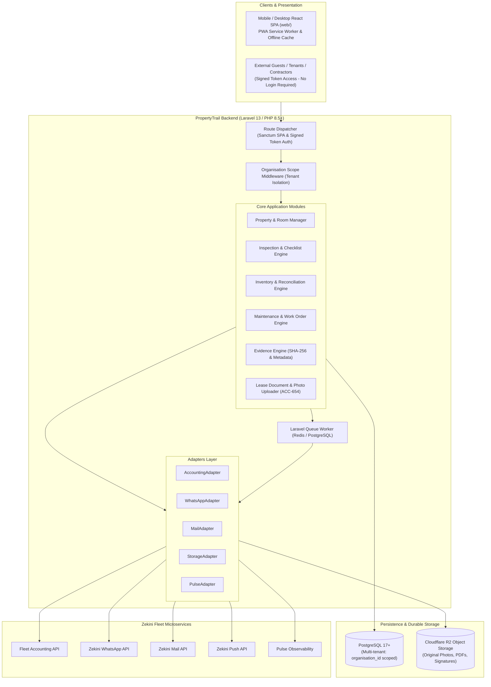
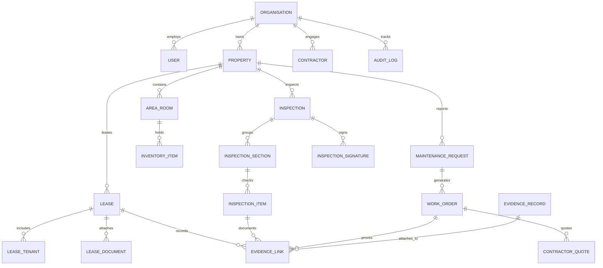
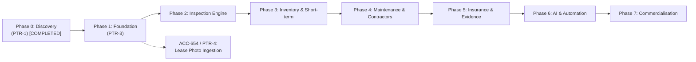

# PropertyTrail — Phase 0: Discovery Report, Integration Matrix & Architectural Plan

**Document Version:** 1.0.0  
**Status:** Approved for Phase 1 Execution  
**Project:** PropertyTrail (PTR)  
**Deliverable for Kadro Card:** [PTR-1](https://kadro.co.za) — *PT Phase 0: discovery of Zekini repos, integration matrix and dev plan*  
**Specification Reference:** `docs/SPEC.md` (Sections 5, 6, 23, 24, 29, 30)

---

## 1. Executive Summary & Objectives

PropertyTrail is a mobile-first property condition, inspection, inventory, maintenance, and evidence management platform designed for both long-term residential and short-term/holiday rentals.

Per **Section 5 and Section 29 of `docs/SPEC.md`**, the mandate for Phase 0 is strict:
1. **Do not rebuild existing functionality.** Inspect the existing Zekini repositories (`~/projects/zekini/`) and Fleet ecosystem.
2. **Reuse central services and packages:** Accounting, WhatsApp, Email, SMS, Pulse, Content Guard, Push, Auth, Durable Storage, and UI conventions.
3. **Decouple via Adapters:** PropertyTrail communicates with external fleet services solely through dedicated adapter interfaces (`App\Adapters\*`) and never couples directly to another service's internal models or database.
4. **Deliverables:**
   - Repository Discovery Report
   - Integration Matrix
   - System Architecture Diagram & Topology
   - Domain Data Model (Multi-tenant PostgreSQL schema)
   - API Conventions
   - Incremental Development Plan (Phase 1 through Phase 7)
   - Dependencies & Prerequisites

---

## 2. Repository Discovery Report

All repositories under `~/projects/zekini/` were inspected on 2026-11-22. Below is the discovery analysis of the fleet ecosystem:

### 2.1 Central Fleet Services

| Repository | Tech Stack | Status | Capabilities & Endpoints | PropertyTrail Reuse Plan |
|---|---|---|---|---|
| **`accounting`** (Fleet Accounting) | Laravel 13, PHP 8.5, Sail, Passport (OAuth2 M2M), Scramble, dompdf | Pre-launch / In development (ACC board) | Synchronous REST for customer billing, subscriptions, invoices, credit notes, statements, ledger. OAuth2 `client_credentials`. Double-entry ledger with immutable journal entries. | **MANDATORY REUSE:** PropertyTrail must NOT implement an independent billing/accounting module. When commercial plans and contractor invoices are billed, call Fleet Accounting's API via `AccountingAdapter`. |
| **`whatsapp`** | Laravel 13, PHP 8.5, Guzzle, Scramble, Anthropic SDK | Production-ready (Xneelo) | Outbound WhatsApp template messages, session messaging, webhook callbacks, opt-in/opt-out lists (`POST /api/v1/instructions`, `GET /api/v1/messages/{id}`). | **MANDATORY REUSE:** Inspection reminders, guest check-in/out instructions, contractor work order assignments, completion notifications. Integrate via `WhatsAppAdapter`. |
| **`mail`** (Zekini Mailer) | Laravel 13, PHP 8.5, AWS SES SDK, Scramble, `laravel/mcp` | Production-ready (Xneelo) | Outbound transactional emails, batch dispatches, delivery tracking, emulator support (`POST /api/v1/instructions`, `GET /api/v1/instructions/{id}`). | **MANDATORY REUSE:** Tenant invitations, PDF inspection report delivery, maintenance notices, insurance evidence packs. Integrate via `MailAdapter`. |
| **`sms`** | Laravel 13, PHP 8.5, Scramble, cURL | Production-ready (Xneelo) | High-reliability SMS dispatch, delivery reports (DLR), sender ID management (`POST /api/v1/messages`). | **MANDATORY REUSE:** Fallback for critical guest access PINs, urgent maintenance dispatches, verification codes. Integrate via `SmsAdapter`. |
| **`push`** | Laravel 13, PHP 8.5, `minishlink/web-push`, Scramble | Production-ready | Web Push notifications (RFC 8030 / VAPID). `GET /api/v1/vapid-public-key`, `POST /api/v1/subscriptions`, `POST /api/v1/instructions`. Supports one-tap unsubscribe. | **MANDATORY REUSE:** Progressive Web App (PWA) push notifications for real-time mobile updates (inspection assignments, guest requests, contractor updates). |
| **`content-guard`** | Laravel 13, PHP 8.5, Octane, Passport | Active service (`POST /check`) | Text analysis, profanity detection, PII detection, risk scoring (`pass`, `flag`, `warn`, `block`). 1-second timeout fail-open rule. | **REUSE:** Sanitize public comments, tenant maintenance reports, and guest feedback. |
| **`pulse`** | Laravel 13, PHP 8.5, GeoIP2, Chromium, Playwright | Production-ready (Xneelo) | Operational observability, system telemetry, user activity events, API call audit trail. | **MANDATORY REUSE:** Product analytics and audit trail monitoring via the official SDK package. |

### 2.2 Reusable Packages & Standards

| Repository | Type | Description & Usage |
|---|---|---|
| **`pulse-laravel-sdk`** | Composer Package | Provides `PulseClient`, `LogEntryForwarder`, `ServerErrorReporter`, and the standard `audit-api-call` middleware. Installed directly in PropertyTrail. |
| **`@zekini/ui`** | NPM Package | Shared UI foundations (Theme provider: Auto, Light, Dark; common token system). |
| **`api-contract`** | Composer Package | Shared contracts for API payloads and response formatting across the fleet. |
| **`standards`** | Fleet Governance | Repository holding standard configurations: `mago.toml` (canonical linter/formatter/analyzer replacing Pint & PHPStan), canonical `CLAUDE.md`, authentication standards, and Cloudflare R2 storage guidelines. |
| **`kadro_agent.py`** | Fleet Orchestrator | Central Python agent managing automated card execution, testing gates, and Kadro MCP sync across all repositories. |

---

## 3. Integration Matrix

The following matrix defines how PropertyTrail interfaces with each external capability. All interactions are abstracted through contracts inside `app/Contracts/Adapters/` and implementations inside `app/Adapters/`.

```
+-----------------------------------------------------------------------------------+
|                                 PropertyTrail App                                 |
|                                                                                   |
|  [Inspection Engine]   [Inventory]   [Maintenance]   [Evidence]   [Tenancy/Auth]  |
+-----------------------------------------------------------------------------------+
                                         | (Uses Adapters)
                                         v
+-----------------------------------------------------------------------------------+
|                                  Adapters Layer                                   |
|                                                                                   |
|   AccountingAdapter     WhatsAppAdapter     MailAdapter     PulseAdapter          |
|   StorageAdapter        PushAdapter         ContentAdapter  AIProviderAdapter     |
+-----------------------------------------------------------------------------------+
         |                     |                  |                 |
         v                     v                  v                 v
  Fleet Accounting        Zekini WhatsApp    Zekini Mail      Pulse SDK & R2
```

| Domain | Fleet Resource | Contract / Adapter | Protocol & Authentication | Fallback / Failure Mode |
|---|---|---|---|---|
| **Billing & Invoices** | `accounting` | `AccountingAdapterInterface`<br>`FleetAccountingAdapter` | REST API, OAuth2 `client_credentials` | Queue failed dispatches in `billing_events_outbox` for exponential backoff retry. |
| **WhatsApp Messages** | `whatsapp` | `WhatsAppAdapterInterface`<br>`ZekiniWhatsAppAdapter` | REST API (`POST /api/v1/instructions`), Bearer token + Idempotency-Key | Fall back to SMS if urgent; log delivery failure in audit log. |
| **Email Delivery** | `mail` | `MailAdapterInterface`<br>`ZekiniMailAdapter` | REST API (`POST /api/v1/instructions`), Bearer token | Queue in Laravel jobs with Redis/DB retry. |
| **SMS Alerts** | `sms` | `SmsAdapterInterface`<br>`ZekiniSmsAdapter` | REST API (`POST /api/v1/messages`), Bearer token | Return error result to caller; non-fatal. |
| **Web Push** | `push` | `PushAdapterInterface`<br>`WebPushAdapter` | REST API / VAPID key | Browser handles subscription; fail silently if ungranted. |
| **Audit & Metrics** | `pulse` & `pulse-laravel-sdk` | `PulseClient`, `audit-api-call` middleware | Direct SDK HTTP client | Fail open (telemetry must never crash application writes). |
| **Content Moderation** | `content-guard` | `ContentGuardAdapter` | REST API (`POST /check`), Bearer token | 1.0s timeout, fail open (`pass`) per Fleet rule. |
| **Durable File Storage** | Cloudflare R2 | `StorageAdapterInterface`<br>`R2StorageAdapter` | S3-compatible API (`league/flysystem-aws-s3-v3`), pre-signed URLs | Local disk caching for temporary upload staging; permanent files stored in R2. |
| **AI Processing** | Multi-vendor (Anthropic, Mistral) | `AIProviderAdapterInterface`<br>`ConfigurableAIAdapter` | REST API with provider rotation | Soft disable: AI suggestions are strictly optional and must never gate core workflows. |

---

## 4. System Architecture & Topology

### 4.1 High-Level Architecture Diagram



### 4.2 Key Architectural Principles
1. **Modular Laravel Monolith**: Backend built in Laravel 13 with clear domain separation (`app/Domains/Property`, `app/Domains/Inspection`, `app/Domains/Inventory`, `app/Domains/Maintenance`, `app/Domains/Evidence`).
2. **React SPA in `web/` (Fleet Pattern A)**: Single-page application served same-origin by the monolith. Built with Vite, React 19, TypeScript, and TailwindCSS.
3. **No Blade UI**: All app screens, forms, wizards, dashboards, and dialogues are React components. Blade is reserved strictly for mail notifications and DomPDF document rendering.
4. **Token-Based External Access**: External participants (tenants signing inspections, contractors submitting quotes/photos, holiday guests checking in) receive secure, signed, time-limited token links (`/external/i/{signedToken}`). No forced registration.
5. **Durable Evidence Integrity**: All photos, signatures, and reports are hashed with SHA-256 upon ingestion, saved to Cloudflare R2, and linked immutably in PostgreSQL with EXIF timestamp and GPS coordinates.

---

## 5. Domain Data Model

Every tenant-owned entity carries an indexed `organisation_id` with global tenant scoping enabled (`BelongsToOrganisation`).

### 5.1 Entity Relationship Diagram



### 5.2 Core Schema Specifications

#### A. Multi-Tenancy & Identity
- `organisations`: `id` (ULID/bigint), `uuid`, `name`, `slug`, `status`, `currency` (default ZAR), `timezone`, `settings` (JSON), `created_at`, `updated_at`.
- `users`: `id`, `uuid`, `name`, `email` (unique), `password`, `two_factor_secret`, `two_factor_recovery_codes`, `two_factor_confirmed_at`, `google_id`, `created_at`, `updated_at`.
- `organisation_user`: `id`, `organisation_id`, `user_id`, `role` (`admin`, `manager`, `inspector`, `viewer`), `permissions` (JSON), `created_at`.
- `terms_acceptances`: `id`, `user_id`, `terms_version`, `ip_address`, `user_agent`, `accepted_at`.

#### B. Properties, Rooms & Inventory
- `properties`: `id`, `organisation_id`, `name`, `reference_code`, `property_type` (`residential_long`, `holiday_short`, `commercial`), `address_line_1`, `address_line_2`, `city`, `province`, `postal_code`, `gps_latitude`, `gps_longitude`, `status`, `created_at`, `updated_at`.
- `areas_rooms`: `id`, `organisation_id`, `property_id`, `name`, `room_type` (`bedroom`, `bathroom`, `kitchen`, `exterior`, `living`, `garage`), `sort_order`, `notes`, `created_at`.
- `inventory_items`: `id`, `organisation_id`, `area_room_id`, `name`, `category`, `expected_quantity`, `condition_grade` (`new`, `good`, `fair`, `poor`, `damaged`), `brand`, `model`, `serial_number`, `created_at`, `updated_at`.

#### C. Leases & Occupancy (including ACC-654 / PTR-4)
- `leases`: `id`, `organisation_id`, `property_id`, `lease_reference`, `start_date`, `end_date`, `monthly_rent_cents`, `deposit_cents`, `status` (`active`, `expired`, `terminated`), `created_at`.
- `lease_tenants`: `id`, `lease_id`, `full_name`, `email`, `phone_number`, `id_number`, `is_primary`, `created_at`.
- `lease_documents`: `id`, `organisation_id`, `lease_id`, `title`, `document_type` (`contract`, `id_copy`, `incoming_photo`, `outgoing_photo`), `evidence_record_id`, `created_at`.

#### D. Inspection Engine
- `inspections`: `id`, `organisation_id`, `property_id`, `lease_id` (nullable), `type` (`incoming`, `outgoing`, `routine`, `turnover`), `scheduled_date`, `performed_at`, `performed_by_user_id`, `status` (`draft`, `in_progress`, `pending_signatures`, `completed`, `locked`), `overall_notes`, `pdf_report_evidence_id`, `created_at`.
- `inspection_sections`: `id`, `inspection_id`, `area_room_id`, `title`, `sort_order`, `status`.
- `inspection_items`: `id`, `inspection_section_id`, `inventory_item_id` (nullable), `name`, `condition_status` (`pass`, `flag`, `fail`, `not_checked`), `cleanliness` (`clean`, `needs_cleaning`, `dirty`), `action_required` (boolean), `comments`, `created_at`.
- `inspection_signatures`: `id`, `inspection_id`, `signer_type` (`inspector`, `tenant`, `landlord`), `signer_name`, `signer_email`, `signature_evidence_id`, `signed_at`, `ip_address`.

#### E. Evidence Engine (Tamper-Evident & Immutable)
- `evidence_records`: `id`, `organisation_id`, `sha256_hash` (unique index), `file_name`, `mime_type`, `file_size_bytes`, `storage_driver` (`r2`), `storage_path`, `captured_at`, `gps_latitude`, `gps_longitude`, `camera_make`, `camera_model`, `uploaded_by_user_id` (nullable for external uploaders), `created_at` (immutable: never updated or hard-deleted).
- `evidence_links`: `id`, `organisation_id`, `evidence_record_id`, `attachable_type`, `attachable_id`, `label` (`incoming_evidence`, `outgoing_evidence`, `damage_photo`, `repair_before`, `repair_after`), `sort_order`, `created_at`.

#### F. Maintenance & Work Orders
- `maintenance_requests`: `id`, `organisation_id`, `property_id`, `reported_by_user_id` (nullable), `reported_by_tenant_name`, `title`, `description`, `urgency` (`low`, `medium`, `high`, `emergency`), `status` (`logged`, `quote_requested`, `work_ordered`, `in_progress`, `completed`, `cancelled`), `created_at`.
- `contractors`: `id`, `organisation_id`, `company_name`, `contact_name`, `email`, `phone_number`, `trade` (`plumbing`, `electrical`, `cleaning`, `general`), `created_at`.
- `work_orders`: `id`, `organisation_id`, `maintenance_request_id`, `contractor_id`, `reference_code`, `access_token` (unique token for contractor portal), `scheduled_date`, `cost_estimate_cents`, `final_cost_cents`, `status`, `completed_at`.

---

## 6. API Conventions & Fleet Standards

PropertyTrail conforms to standard Zekini Fleet API guidelines (`standards/docs/`):

1. **Routing & Versioning**: All internal and public APIs are versioned under `/api/v1/`.
2. **Response Constants**: Controllers must use `Illuminate\Http\Response::HTTP_*` constants, never raw integer status codes.
3. **Mago Toolchain**: Formatting, linting, and static analysis are enforced exclusively by `mago` (`composer lint`, `composer analyse`, `mago.toml`). No Pint, PHPStan, or Larastan.
4. **Repositories & Factories**: Reads must be conducted through Repositories; writes must be conducted through Factories. Eloquent queries must not leak directly into Controllers.
5. **Idempotency**: All retryable creation endpoints (`POST /api/v1/...`) accept an `Idempotency-Key` header.
6. **Standard Error Envelope**:
```json
{
  "message": "Validation failed",
  "errors": {
    "property_id": ["The selected property is invalid."]
  },
  "code": "VALIDATION_ERROR"
}
```
7. **External Token Links**: Signed URLs are generated via `URL::temporarySignedRoute(...)` with fixed expiration and HMAC signature. External users never need account passwords.

---

## 7. Incremental Development Plan

Development will proceed in small, verifiable slices according to Kadro board `PTR`:



### Phase 1 — Platform Foundation (Kadro Card PTR-3)
- **Scope:**
  1. Scaffold Laravel application with Sail, PostgreSQL, and Redis.
  2. Install and configure `mago.toml` and fleet git hooks.
  3. Install `pulse-laravel-sdk` and register telemetry and `audit-api-call` middleware.
  4. Implement Multi-Tenancy: `organisations`, `OrganisationScoped` global scope, and tenancy middleware.
  5. Authentication: Fortify with Sanctum SPA cookies, TOTP 2FA, Google OAuth (Socialite), terms acceptance model.
  6. Core Models & Migrations: Properties, Areas/Rooms, Evidence Records (`R2StorageAdapter`).
  7. Frontend SPA Foundation: Vite, React 19, TypeScript, TailwindCSS, `@zekini/ui` theme integration in `web/`.
  8. Acceptance Tests: Multi-tenant isolation test suite, property CRUD, photo upload to R2 staging.

### Phase 2 — Inspection Engine
- **Scope:**
  1. Inspection templates, section/item checklists, and guided photo requirements.
  2. Mobile PWA camera capture component with offline image queuing.
  3. Signature capture canvas (`signature-pad`) and PDF inspection report generation (DomPDF).
  4. Shareable external inspection review link with tenant sign-off.
  5. Email delivery via `MailAdapter` and WhatsApp notification via `WhatsAppAdapter`.

### Phase 3 — Short-Term Rentals & Inventory
- **Scope:**
  1. Holiday bookings and guest check-in/out workflows.
  2. Room item inventory templates and expected vs actual quantity counting.
  3. Inventory reconciliation reports and cleaner turnover checklists.

### Phase 4 — Maintenance & Contractors
- **Scope:**
  1. Problem reporting flow with photo evidence.
  2. Contractor directory, work orders, and token-based contractor portal.
  3. Quote submission, landlord approval workflow, and before/after evidence validation.

### Phase 5 — Insurance & Advanced Evidence
- **Scope:**
  1. Incident logging and insurance claim preparation.
  2. Chronological evidence timeline generator.
  3. Standalone read-only assessor evidence pack links.

### Phase 6 — AI & Automation
- **Scope:**
  1. Side-by-side photographic comparison for move-in vs move-out.
  2. Automated damage classification and inventory counting hints.
  3. Strictly advisory: AI output requires human confirmation.

### Phase 7 — Commercialisation
- **Scope:**
  1. Tenant subscription plans and usage tiers.
  2. Integration with `accounting` (Fleet Accounting) for billing and subscription invoicing.

### Dedicated Slice: PTR-4 / ACC-654 (Move-in / Move-out Photos per Property & Lease)
- Implemented immediately following Phase 1 foundation: provides incoming/outgoing photo upload and document association per lease and property, satisfying both the Accounting team's request and PropertyTrail's evidence model.

---

## 8. Dependencies, Environment & Prerequisites

### 8.1 Runtime Environment
- **PHP:** 8.5+ with `pdo_pgsql`, `redis`, `gd` / `imagick`, `bcmath`, `curl`, `json`
- **Laravel Framework:** 13.x (`^13.17`)
- **Database:** PostgreSQL 17+
- **Cache & Queue:** Redis 7+
- **Frontend:** Node.js 22+, npm 10+, React 19, TypeScript 5.7+, Vite 6+
- **Local Dev Orchestrator:** Laravel Sail (Docker with PHP 8.5 & PostgreSQL 17)
- **Code Quality:** `mago` (v0.1+)

### 8.2 Production Infrastructure
- **Server:** Xneelo Ubuntu server (`xneelo-fleet`)
- **Web Server:** Nginx + PHP-FPM
- **Durable Storage:** Cloudflare R2 bucket (`propertytrail-evidence`)
- **DNS & CDN:** Cloudflare (`propertytrail.co.za`, `api.propertytrail.co.za`)

---

## 9. Conclusion & Sign-Off

Phase 0 discovery confirms that:
1. All required auxiliary capabilities (Accounting, WhatsApp, Email, SMS, Push, Pulse, Content Guard) exist as stable or actively developed services in `~/projects/zekini/`.
2. PropertyTrail does not need to build bespoke communication or billing infrastructure.
3. The multi-tenant architecture, data model, and adapter abstractions provide clean isolation and adhere to all Zekini Fleet standards.

**Phase 0 is complete. PropertyTrail is ready to begin Phase 1 (PTR-3: Platform Foundation).**
